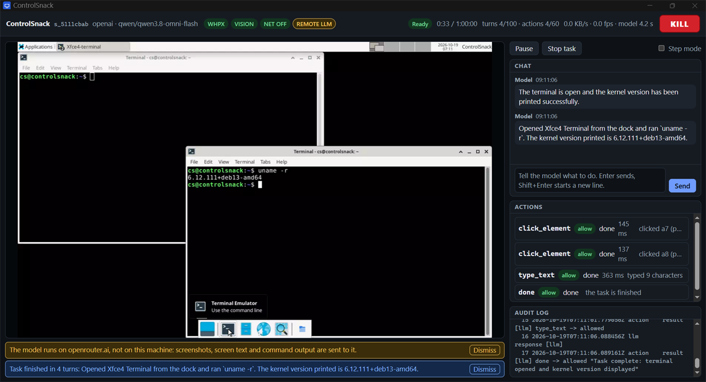

# ControlSnack Local

ControlSnack Local boots a throwaway Debian desktop (XFCE) in a local QEMU virtual machine, shows it in a viewer window on your own machine, and lets a model operate it: it looks at the screen, reads the accessibility tree, clicks, types and runs commands, all through a validated tool API. When the session ends the VM is deleted.

It is one program, written in Go with no cgo, that runs on Linux, macOS and Windows.

> **Status: pre-release.** Everything described here is built and tested, but there are no release binaries yet (build from source, see Quick start), and some paths have been run only on one machine (see [What has and has not been run](#what-has-and-has-not-been-run)). Read that section before you rely on a claim made elsewhere in this file.

**New here?** The [getting-started guide](docs/GETTING-STARTED.md) goes from nothing to a first task, with a model on your own computer or through an API, with screenshots of the real program. Every command, flag and setting is in the [documentation](site/docs.html) 



## 1. What it is, and what it is not

- **It is local.** The VM, the viewer, the audit log and the policy run on your machine. The only thing that leaves is what you send to the model endpoint you choose (see [Privacy](#11-privacy)). A local model (Ollama, LM Studio, llama.cpp) keeps everything on the machine.
- **It is a sandbox first.** The VM has no network device. It shares nothing with the host: no folders, no clipboard, no USB. Every action the model asks for is checked against a policy and written to a hash-chained audit log before it runs. A kill switch ends the VM in milliseconds, from the viewer, from another terminal, or on its own when you walk away.
- **It is not** an account, a service, a cloud, a way to share a session, or anything that phones home. There is no telemetry and no update check. It does not run the model's commands on your machine, ever.
- **It is not a guarantee against everything.** The exec policy is a guardrail and not a security boundary; the boundary is the VM. See [Security caveats](#7-security-caveats).

## 2. Quick start

You need: QEMU, about 2 GB of disk for the image, a Chromium-based browser for the viewer window (Edge, Chrome, Chromium or Brave; any browser works in a tab with `--viewer browser`), and a model server.

**Build from source** (Go 1.26 or newer; the toolchain line in `go.mod` is fetched automatically):

```
go run ./tools/dev build        # builds the guest agents, then dist/controlsnack
```

**1. Install QEMU.**

| OS | Command |
|---|---|
| Linux (Debian, Ubuntu) | `sudo apt install qemu-system-x86 qemu-utils` (for ARM guests add `qemu-system-arm qemu-efi-aarch64`) |
| macOS | `brew install qemu` |
| Windows | `winget install SoftwareFreedomConservancy.QEMU`, or the installer from <https://www.qemu.org/download/#windows> |

If QEMU is somewhere unusual, point to it with `--qemu <directory>` (or `vm.qemu_dir` in the config file).

**2. Ask `doctor`.**

```
controlsnack doctor
```

It changes nothing. It reports your system, the virtualization support, QEMU, the base image, browsers and local model servers, and ends with the verdict a run would act on: `will use kvm`, `whpx` or `hvf`, or `will use tcg (slow)`, or `cannot run a VM` with the steps to fix it. Exit code 0 means a VM can run, 3 means it cannot. `controlsnack doctor --json` prints the same report as JSON.

On Linux, hardware acceleration needs access to `/dev/kvm`: `sudo usermod -aG kvm $USER`, then log in again.

**3. Build the base image (once).**

```
controlsnack image build
```

This downloads the official Debian generic cloud image (checksum-verified), installs the desktop and the guest agent in a one-off provisioning boot (the only time a VM of ControlSnack has outbound networking), and seals the result. With hardware acceleration it takes minutes; with software emulation it took 10 minutes 35 seconds on the author's machine and the image is 765 MiB (`--slow` can take over 30 minutes on slower hardware). On a machine that is offline, build the image elsewhere and bring it with `controlsnack image import`.

**4. Start a model server with a vision model.** For example LM Studio (load a vision model, then Developer tab → Status: Running, which serves `http://127.0.0.1:1234/v1`) or Ollama (`ollama serve`, `ollama pull qwen2.5vl`). A model without vision works in a degraded mode that uses the accessibility tree and the recognized text of the screen only. Check what your model can do with:

```
controlsnack llm probe
```

**5. Run.**

```
controlsnack run --task "Open a terminal and print the kernel version"
```

The viewer opens in a window of its own. Type a task in its chat if you gave none, watch the screen, and press **Kill** (or Ctrl+Shift+Esc, or press Esc three times, or run `controlsnack kill` from another terminal) to end the VM at once.

## 3. Windows Home

Windows Home is supported, and so is Pro. ControlSnack uses the Windows Hypervisor Platform (WHPX) when QEMU can use it, and software emulation (TCG) otherwise, which works on every machine.

- **VT-x / AMD-V in the firmware.** Check Task Manager → Performance → CPU → "Virtualization: Enabled", or run `controlsnack doctor` (the row "firmware virt."). If it is off, enable it in the BIOS/UEFI setup (the setting is usually called Intel Virtualization Technology, VT-x, SVM Mode or AMD-V).
- **Optional features.** WHPX needs **Windows Hypervisor Platform**; it does not need the Hyper-V role. "Virtual Machine Platform" belongs to WSL2 and is not needed for this. Enable the feature in the Windows Features dialog, or from an administrator PowerShell, and reboot:
  ```
  Enable-WindowsOptionalFeature -Online -FeatureName HypervisorPlatform
  ```
  `controlsnack doctor` never elevates and never changes a setting; it only tells you.
- **The WSL2 footgun.** WSL2, Hyper-V, Windows Sandbox and Memory Integrity start the Windows hypervisor, which then holds VT-x; QEMU can use hardware virtualization only through WHPX. So turn on Windows Hypervisor Platform; do not turn WSL2 off. And run the Windows build of ControlSnack, not the Linux build inside WSL2: there `/dev/kvm` exists only with nested virtualization, and without it you get TCG.
- **Expected performance.** KVM (Linux) and HVF (macOS) are the fastest; WHPX is hardware-accelerated but usually slower than KVM on comparable hardware; TCG is several times slower than any of them (a desktop boot takes about a minute instead of seconds). The numbers measured so far are in [Performance](#10-performance): on Windows 10 with WHPX the guest was ready in 12 seconds, against 61 to 75 seconds with TCG. WHPX worked there although the optional feature "Windows Hypervisor Platform" read "disabled" and WSL2 was running: `controlsnack doctor` decides by trying QEMU, and says so.
- **Last resort.** TCG always works: `controlsnack run --slow` (the same as `--accel=tcg`). If WHPX fails to launch, `run` retries once with TCG on its own and warns you in the terminal, in the viewer and in the audit log.
- **Endpoints.** The viewer and the control endpoint listen on `127.0.0.1` only, but on Windows any program that runs as you can connect to a loopback port. See [Security caveats](#7-security-caveats).

## 4. Commands, flags and configuration

| Command | What it does |
|---|---|
| `controlsnack run` | Boot the VM, open the viewer and let the model work on a task |
| `controlsnack doctor` | Report what this machine can run and which accelerator a session would use |
| `controlsnack image build \| import \| ls \| path \| verify \| rm` | Manage the base image |
| `controlsnack llm models \| probe` | List a backend's models; test vision, WebP, native tool calls and structured output |
| `controlsnack kill` | Kill the running session from any terminal (works even if the config file is broken) |
| `controlsnack audit ls \| show \| verify \| prune` | Inspect, verify and prune the audit logs |
| `controlsnack vm ls \| rm` | Manage kept VMs (made with `run --keep-vm`) |
| `controlsnack config show \| path` | Show the effective configuration (secrets masked) and where it comes from |
| `controlsnack schema` | Print the tool schema in a backend's format (`jsonmode`, `openai`, `anthropic`, `ollama`) |
| `controlsnack version` | Print the version, commit, Go version and platform |

**Exit codes:** 0 ok, 1 error (a task the model gave up on, a failure), 2 usage, 3 environment (QEMU, accelerator), 4 image missing, 5 killed or interrupted, 6 timeout, 70 not implemented.

**`run` flags** (all of them; `controlsnack run --help` is the reference):

| Flag | Default | Meaning |
|---|---|---|
| `--task` | | The task. Without one, type it in the viewer chat |
| `--llm` | `auto` | `auto`, `ollama`, `lmstudio`, `llamacpp`, `openai`, `anthropic` |
| `--model`, `--base-url`, `--api-key-env` | | Model name; endpoint (non-local hosts must use https); the NAME of the environment variable that holds the key |
| `--tools` | `auto` | Tool profile: `auto`, `full`, `compact` |
| `--obs-format` | `text` | Observation format sent to the model: `text`, `json` |
| `--marks` | `auto` | Numbered set-of-marks overlay on the screenshot: `auto`, `on`, `off` |
| `--no-llm` | | Boot and hand over without a model, for testing the sandbox (needs `--viewer none`) |
| `--viewer` | `window` | `window` (app-mode browser window), `browser` (a tab), `none` (headless: needs `--task`, and with a model also `--unsafe`, because nobody is watching; the terminal carries everything) |
| `--step` | | Ask for confirmation before every action |
| `--accel`, `--slow` | `auto` | `auto`, `kvm`, `whpx`, `hvf`, `tcg`; `--slow` is `--accel=tcg` |
| `--cpus`, `--memory`, `--resolution` | 2, 2048 MiB, 1280x800 | The guest (resolution up to 1920x1080) |
| `--image`, `--qemu` | newest image; PATH | Which base image; where QEMU is |
| `--allow-net` | off | Let the guest reach the web through a policy-checked HTTP/HTTPS bridge (no LAN, no raw sockets) |
| `--allow-domain`, `--allow-port` | | With `--allow-net`: only these domains (and subdomains); more ports than 80 and 443 |
| `--policy` | | A rule file merged over the built-in rules |
| `--actions-per-sec`, `--actions-per-response`, `--actions-per-task`, `--max-turns` | 2, 3, 60, 100 | Limits; a task asks you to check in when it reaches the budgets |
| `--timeout` | 1h | Session time |
| `--keep`, `--keep-vm[=NAME]`, `--vm NAME` | | Keep the transcript and the pictures the model was shown (in `kept/<session id>` under the state directory); keep the VM disk (its guest is powered off cleanly when the session ends); resume a kept VM |
| `--unsafe` | | Relax limits and confirmations (flag only, never a config key); see below |

**Configuration.** Settings come, in this order of priority, from flags, the environment (`CONTROLSNACK_<SECTION>_<KEY>`, for example `CONTROLSNACK_VM_MEMORY_MIB`), the config file and the defaults. `controlsnack config path` says where the file is and `controlsnack config show` prints what is in force. An API key is read from the environment variable you name with `--api-key-env` (or `OPENAI_API_KEY` / `ANTHROPIC_API_KEY` / `CONTROLSNACK_LLM_API_KEY`); it is never written to the audit log, the viewer or the config output.

**Where things live.**

| | Linux | macOS | Windows |
|---|---|---|---|
| Config | `~/.config/controlsnack` | `~/Library/Application Support/controlsnack` | `%AppData%\controlsnack` |
| Images, model probe cache | `~/.cache/controlsnack` | `~/Library/Caches/controlsnack` | `%LocalAppData%\controlsnack` |
| Audit logs, kept VMs, session lock | `$XDG_STATE_HOME/controlsnack` (default `~/.local/state/controlsnack`) | `~/Library/Application Support/ControlSnack` | `%LocalAppData%\ControlSnack` |

Audit logs are kept 30 days (`audit.retention_days`; `controlsnack audit prune`).

**`--unsafe`** raises the rate limits fivefold, allows up to 10 actions per response, 500 per task and 500 turns, turns confirm-class rules into allow (still audited) and deny-class rules into confirm, allows an 8-hour session, headless runs with a model, and plain-HTTP remote model endpoints. The viewer shows an UNSAFE badge and the audit log records it. It never relaxes the kill switch, the audit log, the loopback-only viewer, the untrusted-text fence or the no-network-device guarantee.

## 5. Threat model

**Assets:** files on the host; the host's and the LAN's network; API keys; your consent to each risky action; the integrity of the audit log.

**Adversaries:**
- Prompt-injected content: text on the screen, in a web page, in a file or in command output that tries to give the model orders.
- A mistaken or misaligned model: one that tries something destructive without being told to.
- Malicious pages the guest reaches under `--allow-net`.
- Malware inside the guest (assume the guest is compromised as soon as the model has acted in it).

**Trust boundaries.**

| Trusted | Untrusted |
|---|---|
| You (chat, confirmations, controls); the host program's code; the embedded policy and prompts | Everything the model says; **everything that comes from the guest** (agent replies, screenshots, accessibility text, command output, web content); a remote model provider (it receives screen content) |

The invariant: nothing that originates in the model or the guest can cause code to run on the host, read a host file, or open a host network connection, other than the policy-checked connection dialed for `--allow-net`.

**In scope:** the invariants in the next section. **Out of scope:** a hypervisor or QEMU zero-day (mitigated by a minimal device set and, on Linux, QEMU's seccomp sandbox); other processes running as your user or as an administrator; physical access to the machine.

## 6. Sandbox guarantees

Each guarantee holds even with `--unsafe`, and each one has a test.

| Guarantee | Mechanism | Test |
|---|---|---|
| Every listener binds `127.0.0.1` and nothing else | One helper (`platform.ListenLoopback`) opens listeners; `go run ./tools/dev check` rejects any other file that opens one or binds a wildcard address | `TestListenLoopbackBindsOnlyLoopback`, `TestAssertLoopbackAddr` (`internal/platform`); `TestTheServerListensOnLoopbackOnly` (`internal/viewer`) |
| The VM shares nothing with the host and has no network device | The QEMU command line is built by pure functions; none of `-virtfs`, `-fsdev`, `virtiofs`, `-netdev`, any `-nic` other than `none`, `hostfwd`, `-vnc`, `-spice`, `usb-host`, `vfio`, `-monitor`, `-gdb` and the like can appear; the provisioning profile with a network is a separate builder that `run` cannot select | `TestForbiddenFlagInvariant` (`internal/vm/qemu`), `TestForbiddenFlags` (`internal/safety`), golden command lines for every architecture and accelerator |
| `--allow-net` reaches the public web only | The guest's proxy talks to the host over a serial channel; the host dials after a policy check (allow/deny lists, ports) and **always** refuses loopback, private, link-local, metadata and other non-public addresses, judging every address a name resolves to | `internal/safety/egress` tests (ranges, resolution, lists), `TestRealDialerCannotReachLoopback`; end to end: `TestE2ESessionWithoutAllowNetTheGuestHasNoWayOut`, `TestE2ESessionWithAllowNetOnlyWhatThePolicyAllowsGetsThrough` |
| No tool runs on the host | The model's tools become requests to the agent inside the guest and nothing else | `internal/session` executor tests (`exec_test.go`); the e2e scenarios |
| Every action is validated, then judged, then written down, and only then run | Schema check → host policy (with the guest's real coordinates) → profile → confirmation → limits → audit decision → execution → audit result | `TestAnActionIsNotRunUnlessItsDecisionIsOnRecord`, `TestADeniedActionIsNeverRunNeverChargedAndAlwaysRecorded` (`internal/session`) |
| The kill switch works from every trigger and cannot be turned off | Viewer button and hotkeys, `controlsnack kill`, Ctrl+C, the dead-man switch, a failed audit write; it ends QEMU directly and verifies the process before it signals it | `internal/safety/killswitch` tests; `TestE2ESessionAKillEndsTheVmInUnderHalfASecondWhateverTheModelIsDoing` (the VM stopped 8 to 13 ms after the signal) |
| The audit log is always written and hash-chained | One JSON record per line, each carrying the hash of the one before; the decision of an action is on record before the action runs; a log that cannot be written ends the session | `TestChainIsBuiltAsSpecified`, `TestTamperingIsDetected`, `TestWriteFailureIsStickyAndFatal` (`internal/safety/audit`); every e2e log is verified |
| Untrusted text is fenced; the viewer shows text only | What comes from the guest reaches the model inside a fence with a per-session random nonce that the content cannot forge or close; the page builds its elements with `textContent`, and the gate rejects `innerHTML` and similar | `TestContentCannotForgeOrCloseAFence` (`internal/safety/untrusted`); `tools/dev` web checks; `TestE2ESessionWhatAFileSaysIsFencedAndACommandItAsksForIsStillRefused` |
| Only you can reach the viewer | A single-use login link sets a strict cookie; every request needs the exact `Host: 127.0.0.1:<port>`; the socket and the kill button need the cookie, a CSRF value and the right `Origin` | `TestTheHostHeaderMustBeTheViewersAddress`, `TestALoginLinkWorksOnceAndSetsAStrictCookie`, `TestTheSocketNeedsTheCookieAndTheOrigin`, `TestTheKillButtonNeedsTheCookieTheCSRFValueAndTheOrigin` (`internal/viewer`) |
| A viewer that goes away pauses the model | The dead-man switch pauses the task after 3 seconds without a viewer and ends the session after 60 | `TestTheDeadmanPausesTheTaskWhenThePageGoesAndEndsTheSessionAfterAMinute`; `TestE2ESessionAViewerThatGoesAwayPausesTheTaskAndAfterAWhileEndsTheSession` |

## 7. Security caveats

- **The exec policy is a guardrail, not a boundary.** It stops the mistakes and the obvious attacks (wiping the root, a fork bomb, `curl | sh`, privilege escalation, firewall changes, and so on, see the `DENY-*` and `CONFIRM-*` rules in `internal/safety/policy/default.yaml`), and a shell command that cannot be understood is refused. Code in another language run by an interpreter (`python3 -c ...`, `perl -e ...`) is not analyzed, so it can do anything the guest account can. A command typed into a terminal window with the keyboard is judged by the same rules as the exec tool (each ended line, and what was typed before Return), but a line meant for a program that reads it, such as an editor or a language's prompt, is not shell and is let through. The boundary is the VM: assume the guest can be wrecked.
- **Visual prompt injection.** A page or a picture can show the model text that tries to steer it. The fence applies to text; a model can still be misled by what it sees. Watch the viewer, and keep `--step` on for anything that matters.
- **A remote model receives your screen.** Screenshots, the accessibility tree, recognized text and command output go to whatever endpoint you set. Use a local model for anything private.
- **`--allow-net` lets the model cause real-world effects** (posting, buying, sending) even though the VM is isolated. Use `--allow-domain` to narrow it, and the confirmation rules for network actions stay on.
- **Image provisioning uses user-mode networking** (no model involved): the one-off boot downloads Debian packages.
- **TCG mode is slow**, and a slow guest is a poor judge of whether an action worked; the session waits longer when it runs without acceleration.
- **Windows loopback endpoints.** On Windows any program running as you can connect to a loopback port; the viewer's single-use link, cookie and CSRF value, and the control endpoint's token, are what stop one that is not ControlSnack.
- **macOS quarantine.** An unsigned binary downloaded by a browser is quarantined: `xattr -d com.apple.quarantine ./controlsnack`.

## 8. Prompt-injection notes

What the program does: everything from the guest is wrapped in a fence with a nonce, truncated and stripped of control characters; the system prompt tells the model that fenced text is data and never an instruction; the host policy judges every command and every GUI action whatever the model says it was told; risky actions (deleting, overwriting, exposing a port, a password field, destructive clicks in a GUI) wait for your approval; the audit log keeps the model's arguments and the rules that decided.

What it cannot do: stop a model from being convinced of something false by what it sees. The residual risk is a model that is persuaded to do something the policy allows but you did not want. Human oversight is the control for that: the viewer shows every action as it happens, `--step` asks before each one, and the kill button is always there.

## 9. Model backend compatibility

Only what was tested is listed as tested. "Expected, untested" is a guess, not a promise. The probe (`controlsnack llm probe`) tells you the same facts for your own model.

| Backend | Model | Vision | WebP | Native tool calls | JSON mode | Notes | Tested |
|---|---|---|---|---|---|---|---|
| OpenAI-compatible (OpenRouter) | `qwen/qwen3.8-omni-flash` | yes | yes | yes | yes | Points in pixels; picture-only clicking works. **In whole sessions on Windows:** "open a terminal and print the kernel version" done in 4 turns, 33 s after the desktop was ready; "open the text editor, type a line and save it as hello.txt" done in 9 to 10 turns, and the model checked the file from the command line (D-111) | 2026-10-19 |
| LM Studio | `qwen3-vl-4b-instruct` (Q4_K_M with its projector) | yes | no (JPEG is used) | yes | yes | Points on a 0 to 1000 scale (the probe detects it); 8192-token context; 1.5 to 2.8 s a turn on an RTX 3060 (6 GB). **In a whole session on Windows:** "open a terminal and print the kernel version" was done in 5 turns, 11 s after the desktop was ready, and right; "open the text editor, type a line and save it" was not (it opened `nano` in the terminal and lost its way): a 4B model is at its limit there | 2026-10-18 |
| llama.cpp | Gemma 4 E4B IQ4_NL (no projector) | no (text-only) | n/a | yes, and it sometimes writes calls as words, which the parser reads | yes | 8192-token context; works through the accessibility tree and recognized text | 2026-10-17 |
| Ollama | any vision model | expected, untested with a real model | | | | Tested against the fake server only | |
| Anthropic API | Claude models | expected, untested with a real model | | | | Tested against the fake server only | |

The "tested" rows ran through the whole model layer (probe, prompt, conversation, parser, results) on two small tasks in a simulated desktop (D-83, D-84 in `DECISIONS.md`); the LM Studio and OpenRouter models have also driven whole sessions in a real VM (D-110, D-111).

A model that is too small, or a context that is too short, shows up as a model that repeats itself or whose answers cannot be read. The session pauses after three unusable answers in a row and tells you what to try.

## 10. Performance

Measured on the author's machine, Windows 10 Pro with an Intel Core i7-10870H, in two ways: **natively** (QEMU 11.1.0 for Windows, accelerator **WHPX**) and **in WSL2** (Ubuntu 24.04, QEMU 8.2.2, **software emulation (TCG)**, because `/dev/kvm` could not be used there). x86_64 guest, 2 vCPUs, 2 GB, 1280x800.

| | Measured | Notes |
|---|---|---|
| Boot to agent connected (WHPX, native Windows) | 12 to 13 s | QEMU is up after 10.4 s; the desktop after 11 to 12 s |
| Boot to agent connected (TCG, WSL2) | 61 to 75 s | QEMU is up after 10 s; the desktop after 58 to 68 s |
| Base image build (TCG) | 10 min 35 s | image: 765 MiB |
| Kill to QEMU gone | 8 to 17 ms on Linux; 138 ms on native Windows | the whole session returned in 21 ms and 221 ms; the target was under 500 ms |
| Dead-man switch | pause after 3 s, end after 60 s | |
| A look at the screen (TCG) | about 15 s | observation including the accessibility tree and recognized text |
| Local model turn | 1.1 to 2.4 s | `qwen3-vl-4b-instruct`, RTX 3060, request of about 3.1k tokens |
| Screenshot, 1280x800 | WebP 36 KB; 22 KB at a long edge of 1024; JPEG 50 KB; PNG 115 KB | three windows open |
| Viewer frame, 1080p, WebP q70 | 48 to 56 KB | a terminal and a file manager; 50 ms to encode |
| Viewer bandwidth | 1 KB/s with a still screen; 33 KB/s with a terminal printing five lines a second | the budget is 50 KB/s for a still screen; with tcg the guest's capture, not the budget, limits a moving one to about 1 picture a second |
| Powering off a kept VM | 4.2 to 4.6 s | the guest's own system does it; the data written in the session is there in the next |
| Accessibility tree | 79 nodes, 9.4 KB (file manager); 126 nodes, 14.6 KB (whole desktop) | |
| Guest agent | 11.5 MB (amd64), 10.6 MB (arm64) | embedded in the program |

**Not measured:** KVM and HVF (no machine with one was available), and aarch64 at all. The target of boot-to-ready under 45 seconds with hardware acceleration was met with WHPX.

## 11. Privacy

What leaves your machine, and when:

- **To the model endpoint you choose, every turn:** your task and chat messages, a screenshot, the accessibility tree and recognized text of the screen, and the output of the commands the model ran. With a local model (`--llm auto` looks for Ollama, LM Studio and llama.cpp on `127.0.0.1`) this never leaves the machine. With a remote endpoint it does; the start of the session says so, the audit log records `remote_llm`, and a remote endpoint must use https.
- **During `image build`:** the program downloads the Debian image from `cloud.debian.org`, and the provisioning boot downloads packages from Debian mirrors. No data about you is sent.
- **With `--allow-net`:** the guest's HTTP and HTTPS requests to the domains you allow.
- **Nothing else.** No telemetry, no crash reports, no update checks, no accounts.

Local files: the audit log (the model's actions with their arguments, redacted for secrets), the images, kept VMs if you asked for them (`--keep-vm`), and, with `--keep`, the transcript and the pictures the model was shown (`kept/<session id>` under the state directory: nothing else of the session is left behind). Delete them whenever you like.

## 12. Troubleshooting

Start with `controlsnack doctor`: it names the problem and the fix.

- **"cannot run a VM" / QEMU not found.** Install QEMU (above), or pass `--qemu <directory>`. Exit code 3.
- **A session is very slow.** You are on TCG. `doctor` says why hardware acceleration is not in use (Linux: access to `/dev/kvm`; Windows: the firmware setting and Windows Hypervisor Platform; macOS: Hypervisor.framework, which a guest of the same architecture as the host needs).
- **aarch64 guest does not start.** It needs UEFI firmware (`qemu-efi-aarch64` on Debian and Ubuntu; QEMU's own `edk2-aarch64-code.fd`, which comes with Homebrew's and Windows' QEMU). aarch64 is the least tested path.
- **Exit code 4: image missing.** Run `controlsnack image build`, or `image import` an image built elsewhere. `controlsnack image ls` and `image verify` show what you have.
- **Image build fails to download.** The build needs HTTPS access to `cloud.debian.org` and the Debian mirrors. Behind a proxy or offline, build on another machine and `image import`.
- **The viewer does not open in a window.** No Chromium-based browser (Edge, Chrome, Chromium, Brave) was found, so the viewer opens in your default browser as a tab. Use `--viewer browser` to ask for that on purpose.
- **"no model server found".** The message explains how to start LM Studio or Ollama, or how to name another server (`--llm openai --base-url ... --api-key-env ...`).
- **The model repeats itself or the task pauses.** Run `controlsnack llm probe`. A small context (for LM Studio, the context length it was loaded with; for Ollama, `llm.num_ctx`) and a model without vision are the usual causes. The pause message says what it saw.
- **A task pauses and "nobody is there to resume it".** That is a headless run (`--viewer none --unsafe`): with no viewer there is nobody to press Resume, so the run ends with exit code 1 and the reason.
- **Another session is running.** Only one runs per user. `controlsnack kill` ends it; a stale lock from a crash is cleaned up.

## 13. License, third-party notices, roadmap

ControlSnack Local is licensed under the **GNU Affero General Public License v3.0 only** (`LICENSE`); the copyright is Dr. Manuel Herrador's. Third-party Go modules are permissively licensed only (Apache-2.0, MIT, BSD-2-Clause, BSD-3-Clause, ISC); the gate checks it for the host program and the guest agent. Their license texts are in `THIRD_PARTY_LICENSES.md`, which is generated from the dependencies and checked by the same gate; QEMU, the Debian packages in the image and the models are not distributed with the program (that file says so). Outside contributions need a signed Contributor License Agreement (`CONTRIBUTING.md`).

This edition is one person, one machine. Multi-machine and team features are not part of it.

---

## What has and has not been run

So that this file does not claim more than was done:

- **Run for real** (a real VM in WSL2 on Windows 10, QEMU 8.2.2, TCG, x86_64): image build; boot and the agent; every agent request; the guest's network proxy and the host bridge; and nine end-to-end scenarios of a whole `run` session with a *scripted* model: an editor opened, typed in and read back; a command that would wipe the guest refused and recorded; an injection in a file fenced; an action approved and another rejected through the viewer's socket; a kill; `--allow-net` on and off; a viewer that goes away; the agent stopped in a running guest (the session carries on through QEMU's screen and keyboard). Every audit log in them verifies and no QEMU is left behind.
- **Run natively on Windows 10** (QEMU 11.1.0, WHPX, the base image imported from the WSL build, the viewer window in Microsoft Edge, LM Studio's `qwen3-vl-4b-instruct`): `doctor`, `image import`, `llm probe`, whole sessions with a real model (with the 4B local model one task done and one not, D-110; with the OpenRouter model both done, D-111), the kill from a second terminal, the viewer's login and its end. This is where the probe of QEMU for Windows, the pause before a click and the panel launchers were found wrong and fixed (D-110).
- **Run for real with real models, but not in a full session:** the model layer (probe, prompt, parser) against three models (table above); llama.cpp has not driven a session.
- **Not run:** a full `run` with Ollama, the Anthropic API or llama.cpp; KVM and HVF; macOS by a person (the tests pass on GitHub's macOS runner since D-113, but nobody has run QEMU with HVF, or the viewer, on a Mac); aarch64 guests; the viewer window in browsers other than Edge and Chrome; long tasks; any task that needs more than a few steps with a model larger than 4B. The code for these exists and is covered by unit tests with fakes, but "unit-tested" is all that can be said.

---

<p align="center">Made with ❤️ for the Local AI Community by PacifAIst</p>
