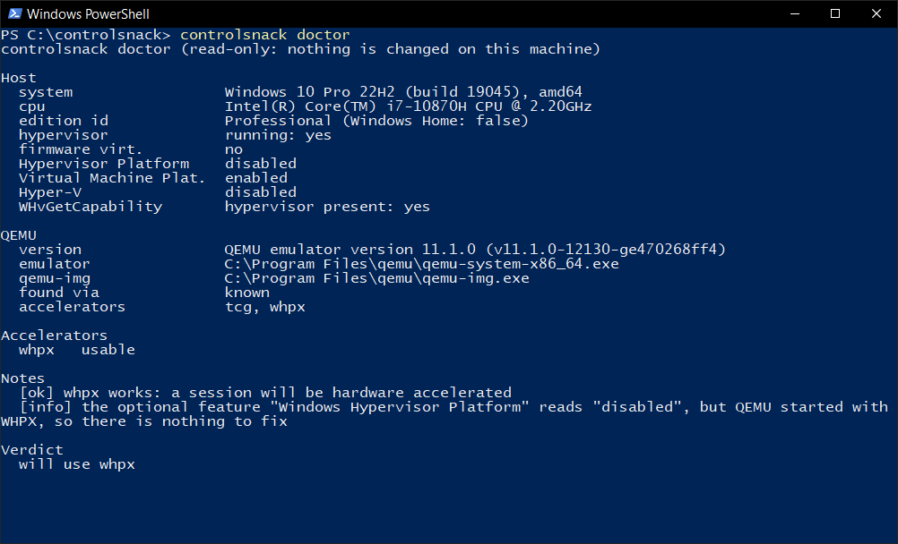
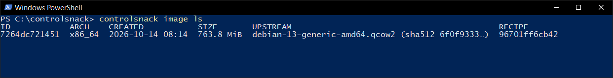
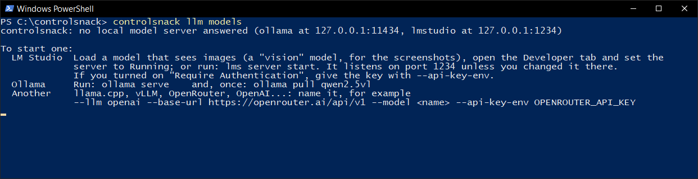

# Getting started with ControlSnack

ControlSnack lets an AI model use a computer for you, safely. It starts a small throwaway Linux computer inside a window on your machine (a virtual machine), shows you its screen, and lets the model look at that screen, click, type and run commands in it. Everything the model does is checked first and written down, and the little computer is deleted when you are done. Your own files are never in reach.

This guide takes you from nothing to a first task, step by step, with screenshots of the real program. You need two things: ControlSnack and a model. The model can run **on your own computer** (path A) or be **rented through an API** (path B). The setup in the middle is the same for both.

Every command, flag and setting is described in the [documentation](https://controlsnack.smartcityjaen.workers.dev/docs) (the same text is in [`site/docs.html`](../site/docs.html)); this guide is the short road.

- [Which path should I pick?](#which-path-should-i-pick)
- [Setup, once (both paths)](#setup-once-both-paths)
- [Path A: a model on your own computer](#path-a-a-model-on-your-own-computer)
- [Path B: a model through an API (OpenRouter)](#path-b-a-model-through-an-api-openrouter)
- [Reading the viewer](#reading-the-viewer)
- [If something goes wrong](#if-something-goes-wrong)

## Which path should I pick?

| | A. A model on your computer | B. A model through an API |
|---|---|---|
| **Privacy** | Nothing leaves your computer. | Every turn sends a screenshot of the little computer, the text of its screen and command output to the provider. ControlSnack tells you so each time it starts. |
| **Cost** | Free, after the download. | You pay the provider per use. Prices differ per model; look up your model's price before long runs. |
| **What you need** | A program that serves models (LM Studio or Ollama), a few GB of disk, and ideally a graphics card with 6 GB or more. It was tested on a laptop with a 6 GB card. | An account with a provider and an API key. Any computer that can run the virtual machine. |
| **How well it works** | A small model (4 billion parameters) did the simple task and failed the harder one in the author's tests. Bigger models do better and need more memory. | A hosted Qwen model did both tasks in the same tests. |

If you only want to see it work, take path B for the first run. If privacy or cost matters more, take path A and start with the simplest task.

## Setup, once (both paths)

These steps are in a terminal: PowerShell on Windows, any terminal on macOS and Linux. The screenshots show the command as `controlsnack`. If you did not put the program on your PATH, type `.\dist\controlsnack.exe` (Windows) or `./dist/controlsnack` instead.

### 1. Install QEMU, Git and Go

QEMU is the program that runs the virtual machine; Git and Go are needed to get and build ControlSnack until there are downloads to use instead.

```powershell
winget install SoftwareFreedomConservancy.QEMU     # Windows (PowerShell), one line each
winget install Git.Git
winget install GoLang.Go
```

```sh
brew install qemu git go                                      # macOS
sudo apt install qemu-system-x86 qemu-utils git golang-go     # Debian, Ubuntu
```

Open a new terminal afterwards so it can find them. On Linux, hardware acceleration also needs access to `/dev/kvm`: `sudo usermod -aG kvm $USER`, then log in again.

### 2. Get and build ControlSnack

```sh
git clone https://github.com/PacifAIst/controlsnack
cd controlsnack
go run ./tools/dev build
```

This takes a minute or two and leaves the program in the `dist` folder.

### 3. Ask `doctor` whether your computer can run it

```sh
controlsnack doctor
```



The report ends with a verdict. `will use whpx` (Windows), `kvm` (Linux) or `hvf` (macOS) means the virtual machine will be fast. `will use tcg (slow)` still works, only several times slower. `cannot run a VM` comes with numbered steps to fix it.

### 4. Get the base image (the Debian desktop), once

```sh
controlsnack image build
```

It downloads Debian, installs a desktop in a one-off boot and saves the result, about 765 MiB. It asks before it downloads. With hardware acceleration this takes minutes; with software emulation it took about 10 minutes on the author's machine and can take over 30 on slower ones. If someone gave you an image file and its `manifest.json`, `controlsnack image import file.qcow2 --manifest manifest.json` takes seconds instead.

```sh
controlsnack image ls
```



One image is all you need. Every session starts from a fresh copy of it, so the image itself never changes.

## Path A: a model on your own computer

The model has to be able to *see*, because the screen reaches it as a picture. The steps below use LM Studio, which was tested. Ollama works the same way in principle and is at the end of this part.

### A1. Install LM Studio and download a vision model

Install LM Studio from its website (`lmstudio.ai`). In its search, look for a Qwen3-VL model of 4 billion parameters or more (the tests used `qwen3-vl-4b-instruct`, a 4-bit version, about 3 GB) and download it. Pick a model that can see images: a model that cannot see still works, but only through the accessibility tree and recognized text, and does less.

### A2. Load it with a long enough context

Each turn sends a screenshot, and a screenshot costs many tokens, so the context length matters. Load the model with a context length of at least **8192** (16384 if your memory allows). With a shorter one the model forgets what it was doing, repeats itself, or gives answers that cannot be read, and the session pauses after three of those in a row.

### A3. Start the server

In LM Studio open the **Developer** tab and set the server to **Running**. It listens on port 1234, on your own machine only. If you turned on "Require Authentication", give the key with `--api-key-env` as in path B.

### A4. Check that ControlSnack can see it

```sh
controlsnack llm models
```

You should see your model with `yes` in the VISION column and the context length you loaded. If the server is not running, this is what you get, and it tells you what to do:



That is the real message when nothing answers. Start the server (step A3) and run the command again. Then test what the model can do:

```sh
controlsnack llm probe --llm lmstudio --model qwen3-vl-4b-instruct
```

It asks the model six small questions (can it see, does it take WebP, can it point at things, can it call tools, can it answer in JSON) and prints `ok` or what failed. The probe of the API model in path B shows what a pass looks like.

### A5. Run the first task

```sh
controlsnack run --llm lmstudio --model qwen3-vl-4b-instruct --task "Open a terminal and print the kernel version"
```

The virtual machine starts (12 seconds with hardware acceleration), a window opens with its screen, and the model starts working. What you see is described in [Reading the viewer](#reading-the-viewer). The screen looks the same as in path B, except that the top bar shows `lmstudio` and the model's name and has no **REMOTE LLM** badge.

> **What to expect.** In the author's test the 4-billion-parameter model opened the terminal and printed the kernel version in 5 turns, 11 seconds after the desktop was ready, and it was right. It did *not* manage the harder task (open the text editor, type a line, save it as `hello.txt`): it opened the wrong program and lost its way, and the program stopped it after it started repeating itself. That says something about a small model, not about your setup. Try a bigger model, or give smaller steps.
>
> The screenshots in this guide come from path B, because the local server was not running when they were taken; the viewer is the same window whichever model drives it.

### Ollama instead

```sh
ollama pull qwen2.5vl
ollama serve
controlsnack run --llm ollama --model qwen2.5vl --task "Open a terminal and print the kernel version"
```

The Ollama path was tested only against a stand-in server, not yet with a real model.

## Path B: a model through an API (OpenRouter)

OpenRouter is one account that gives access to many models. The test below used `qwen/qwen3.8-omni-flash`. Any provider with an OpenAI-compatible API works the same way; OpenAI and Anthropic have their own settings in the [recipes](https://controlsnack.smartcityjaen.workers.dev/docs#recipes).

### B1. Make an account and a key

Create an account at `openrouter.ai`, add a few dollars of credit, and make an API key on your account's keys page. Copy it once, when it is shown. **Treat it like a password**: whoever has it can spend your money.

### B2. Give the key to the terminal without showing it

ControlSnack never takes the key on the command line. It takes the *name* of an environment variable that holds the key. In PowerShell, this asks for the key without showing it, and keeps it only in this window:

```powershell
$k = Read-Host "OpenRouter key" -AsSecureString
$env:OPENROUTER_API_KEY = [System.Net.NetworkCredential]::new("", $k).Password
```

In bash or zsh: `read -rs OPENROUTER_API_KEY; export OPENROUTER_API_KEY`. Close the window and the key is gone from it.

### B3. Test the model

```sh
controlsnack llm probe --llm openai --base-url https://openrouter.ai/api/v1 --model qwen/qwen3.8-omni-flash --api-key-env OPENROUTER_API_KEY
```


A model that passes all six. Note the warning at the top: with a hosted model, screenshots, screen text and command output are sent to the provider.

### B4. Run the first task

```sh
controlsnack run --llm openai --base-url https://openrouter.ai/api/v1 --model qwen/qwen3.8-omni-flash --api-key-env OPENROUTER_API_KEY --task "Open a terminal and print the kernel version"
```


The terminal tells the story of the session: the boot, the task, and the model's own summary at the end. This run: a 12-second boot, then 4 turns and 33 seconds from the desktop being ready to the end of the task.

At the same time a window opened with the little computer's screen. The next part walks through it.

## Reading the viewer

The viewer is the window that opens when a session starts. These pictures are from the run above, a few seconds apart.

![The ControlSnack viewer window just after the start. The top bar shows the session id, openai and the model name, the badges WHPX, VISION, NET OFF and REMOTE LLM, the state Working, a timer, turn and action counters, and a red KILL button. On the left is the guest desktop: an empty XFCE desktop with a panel at the top and a dock at the bottom. On the right are Pause, Stop task and Step mode, the chat and the list of actions, both empty, and the audit log with its first line. A yellow bar at the bottom says the model runs on openrouter.ai.](../site/img/viewer-start.png)

The start, three seconds in. The model has not done anything yet; the audit log already has its first line (you logged in to the viewer).

- **The top bar.** The session, the backend and the model; **WHPX** says the machine is hardware accelerated (it says **TCG** when it is not); **VISION** says the model sees pictures (it says **TEXT-ONLY** otherwise); **NET OFF** says the little computer has no internet (**NET ON** with `--allow-net`); **REMOTE LLM** appears when the model is not on your machine. Then the state, the time used out of the time allowed, the turns and actions used, and how fast pictures and the model are going.
- **KILL** ends the virtual machine at once.
- **The screen** is the little computer's screen, live. This is what the model sees too.
- **Pause** holds the model's task and **Resume** continues it; **Stop task** ends the task and leaves the machine up for the next; **Step mode** asks you before every action.
- **Chat.** Type a task here if you did not give one on the command line. The model's own words appear here as it works, and your answers to its questions.
- **Actions** lists what the model did: the tool, whether the rules allowed it, and how it went. **Audit log** is the tail of the session's audit log: one line for each record as it is written, the same lines `audit show` prints afterwards.


Seven seconds in. The model found the terminal launcher in the dock and clicked it, and a terminal opened. The action appears in the list, and the audit log shows the decision about it: `click_element -> allowed`.


The end, 33 seconds after the desktop was ready. The front terminal shows the command and its output, the chat has the model's summary, and the state went back to **Ready**: the session waits for your next task and does not end by itself. (The model clicked the launcher a second time before the first window had appeared, so two terminals opened. Models make small slips like this, which is one reason you can watch.)

To end the session, press **KILL**, press `Ctrl`+`C` in the terminal, or run `controlsnack kill` in another one. The little computer is deleted. More ways to stop it are in the [documentation](https://controlsnack.smartcityjaen.workers.dev/docs#stopping).

### A longer task

The same model, asked to open the text editor, type a line and save it as `hello.txt` in the home folder:

![The viewer at the end of a longer task. The text editor Mousepad is open with the title ~/hello.txt and the line hello from controlsnack. The chat shows the model's final summary: it opened Mousepad, typed the line, saved it as /home/cs/hello.txt through File, Save As, and verified on disk that the 23-byte file exists with the right content. The actions list ends with set_text, key, a click_element that failed, an exec and done. A blue bar says the task finished in 10 turns. The audit log shows the last records.](../site/img/viewer-editor.png)

Done in 10 turns, 1 minute 22 seconds after the desktop was ready (the timer at the top). The title bar says the file is saved as `~/hello.txt`, and the model checked it from the command line before it said it was done. One action in the list says **failed**: the model clicked a Save button that had already gone because the dialog had closed. A failed action is not an error of the program; the model is told what happened, reads the screen again and goes on.

### Look at what happened afterwards

Every session leaves an audit log, whether or not you kept anything else. The session id is in the top bar of the viewer and in the terminal (`s_651fec0b` here). `audit show` takes it; `audit verify` takes the path of the log file, which `audit ls` names and which is in the audit folder.

```powershell
controlsnack audit show s_651fec0b
controlsnack audit verify "$env:LOCALAPPDATA\ControlSnack\audit\20261019-s_651fec0b.jsonl"
```


The audit log of the editor session: what the model asked for, what the rules decided, in order, with the reason the model gave for each action. Every action here was allowed. The `kill` near the end is from `controlsnack kill`, which ended the session after the task was done. `audit verify` checks that no record was changed, removed or reordered.

## If something goes wrong

| What you see | What to do |
|---|---|
| `no local model server answered` | Start LM Studio's server (step A3) or Ollama, or name another server with `--llm`, `--base-url` and `--model`. |
| `the environment variable OPENROUTER_API_KEY is empty or not set` | Do step B2 again in *this* terminal window. A variable set in another window is not here. |
| `cannot run a VM` or exit code 3 | Run `controlsnack doctor`; it lists the fixes. Most often QEMU is not installed or not found (`--qemu` points to it). |
| Exit code 4, no base image | Do setup step 4: `controlsnack image build`, or `image import`. |
| It is very slow | The verdict of `doctor` was `tcg`. Hardware acceleration needs virtualization turned on in the firmware, and on Windows the "Windows Hypervisor Platform" feature may help. `doctor` says what applies. |
| No window opened | No Edge, Chrome, Chromium or Brave was found, so the viewer opened in your default browser instead, or its address was printed. `--viewer browser` asks for the browser on purpose. |
| The model repeats itself, or the task pauses | Run `controlsnack llm probe`. Usual causes: a context that is too short (load the model with 8192 or more), or a model that cannot see. Press **Resume**, or **Stop task** and give a smaller task. |
| The model asks you something, or a box asks you to approve an action | The rules want your say. Answer in the chat, or press Approve or Reject. An action nobody answers within two minutes counts as rejected. |
| Another session is running | Only one runs at a time per user. `controlsnack kill` ends it. |

When you are ready for more: the [documentation](https://controlsnack.smartcityjaen.workers.dev/docs) has every command and flag, commands for other models, for letting the guest browse a site, for scripts and for keeping a machine between sessions, and how to change what the model may do with a policy file. [`TESTING.md`](../TESTING.md) is the step-by-step test of a new machine, and the [README](../README.md) says what has and has not been run.
